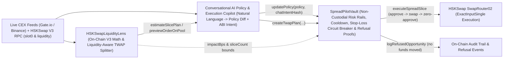

# SpreadPilot HSK

> **Cross-Venue Spread Arbitrage & Liquidity-Aware TWAP AI Trading Agent for HashKey Chain (HSK Chain)**
> **HSK Chain Horizon Hackathon · Seoul — Track 1: AI Agent Trading**

[-363636)](contracts/foundry.toml)
[-10b981)](contracts/test/)
[](web/src/lib/spreadEngine.test.ts)
[](LICENSE)

---

## Why SpreadPilot HSK? (Grounded in Live HSK Chain Mainnet Telemetry)

Generic AI vault bots treat every DEX pool as infinitely deep and fire naive single-shot market swaps. Live inspection of **HSKSwap V3 on HSK Chain Mainnet (`Chain ID 177`)** shows why that fails on an emerging L2 orderbook:

- **`WHSK/USDT` 0.05% pool** (`0xEB33d6666dd2359cB1BF6Ea6D72286Cc1b4a778A`) and **`WHSK/USDT` 0.30% pool** (`0x0767F7b1af495D245EA00219cFB8B2Ed6EafAe62`) exhibit **thin concentrated active liquidity** alongside **persistent inter-pool (`0.05%` vs `0.30%`) and CEX (`Gate.io` `HSK_USDT`) price dislocations**.
- A naive single-shot swap against thin active tick liquidity destroys its own arbitrage edge through price impact before the trade finishes settling.
- **SpreadPilot HSK** solves this end-to-end: it streams live CEX quotes (`Gate.io` & `Binance`) alongside direct HSKSwap V3 on-chain `slot0()` / `liquidity()` reads, computes the exact liquidity-aware **TWAP slice plan** on-chain via `HSKSwapLiquidityLens`, and executes every slice through a **non-custodial, owner-controlled `SpreadPilotVault`** enforcing hard risk rails, a **mark-to-market stop-loss circuit breaker**, and **verifiable on-chain refusal proofs** when spreads or risk gates fail.

---

## System Architecture



### Core Components

| Layer | File(s) | Responsibility |
| :--- | :--- | :--- |
| **On-Chain V3 Liquidity & TWAP Lens** | [`contracts/src/HSKSwapLiquidityLens.sol`](contracts/src/HSKSwapLiquidityLens.sol) | Zero-gas `inspectPool`, `sqrtPriceX96ToPrice1e8`, deterministic fixed-point `estimateSlicePlan`, and single-call `previewOrderOnPool` computing optimal slice count and impact savings (`estimatedBpsSaved`). |
| **Non-Custodial Risk-Gated Vault** | [`contracts/src/SpreadPilotVault.sol`](contracts/src/SpreadPilotVault.sol) | Owner-only deposits & unconditional non-custodial `withdraw` (even when paused or circuit-breaker tripped); conversational `updatePolicy(..., chatIntentHash)`; risk presets (`CONSERVATIVE` / `BALANCED` / `AGGRESSIVE`); multi-slice `createTwapPlan` & `executeSpreadSlice` with exact balance-delta verification and zero-allowance reset; `logRefusedOpportunity`; `reportMarkToMarketAndCheckStopLoss` auto-tripping circuit breaker. |
| **Domain Types & Refusal Codes** | [`contracts/src/SpreadPilotTypes.sol`](contracts/src/SpreadPilotTypes.sol) | Canonical structs (`ExecutionPolicy`, `TwapOrder`, `PositionStats`, `PoolSnapshot`, `SlicePlan`) and 7 verifiable refusal reason codes (`REFUSAL_SPREAD_BELOW_MIN` through `REFUSAL_STALE_QUOTE`). |
| **HSK Testnet Scripts & Adapter** | [`contracts/script/DeployHSKTestnet.s.sol`](contracts/script/DeployHSKTestnet.s.sol), [`contracts/script/RunDemoScenario.s.sol`](contracts/script/RunDemoScenario.s.sol), [`contracts/src/TestnetHSKSwapAdapter.sol`](contracts/src/TestnetHSKSwapAdapter.sol) | Reproducible 1-command HSK Chain Testnet (`133`) deployment + full E2E scenario proving deposit -> chat policy update -> 3-slice TWAP -> slice 1 & 2 fills -> tight-spread refusal proof -> stop-loss breaker trip -> slice 3 on-chain block. |
| **Real-Time Trading Desk & Copilot UI** | [`web/src/App.tsx`](web/src/App.tsx), [`web/src/lib/marketFeeds.ts`](web/src/lib/marketFeeds.ts), [`web/src/lib/chatAgent.ts`](web/src/lib/chatAgent.ts), [`web/src/lib/spreadEngine.ts`](web/src/lib/spreadEngine.ts) | Live CEX↔HSKSwap V3 spread matrix, thin-liquidity single-shot vs. TWAP impact simulator, deterministic zero-key conversational copilot generating structured policy diffs & exact Solidity ABI previews, live risk rail telemetry, and EIP-1193 HSK Testnet (`133`) wallet connector. |

---

## Track 1 Compliance Checklist (AI Agent Trading)

| Track 1 Requirement | SpreadPilot HSK Implementation | Verification |
| :--- | :--- | :--- |
| **Live Market Monitoring** | Streams HSK Mainnet (`177`) & Testnet (`133`) block heights, HSKSwap V3 `WHSK/USDT` `0.05%` & `0.30%` pool states, plus `Gate.io` & `Binance` spot quotes every 10s with graceful fallback. | [`web/src/lib/marketFeeds.ts`](web/src/lib/marketFeeds.ts) |
| **On-Chain Data Analysis** | Decodes raw Uniswap V3 `sqrtPriceX96` and active tick `liquidity()` both on-chain (`HSKSwapLiquidityLens.sol`) and in the client engine (`decodeSqrtPriceX96ToPrice`). | `test_LiquidityLens_InspectPoolAndSqrtPriceMath`, `spreadEngine.test.ts` |
| **Real-Time Spread & Arbitrage Detection** | Tracks CEX↔HSKSwap and HSKSwap `0.05%`↔`0.30%` inter-pool spreads, deducting pool fee tier, TWAP price impact, and L2 gas buffer to compute executable `netEdgeBps`. | [`web/src/lib/spreadEngine.ts`](web/src/lib/spreadEngine.ts) |
| **Liquidity-Aware TWAP Splitting** | Splits orders across both `maxSliceNotional` and pool-depth impact ceiling (`estimateSlicePlan` / `planLiquidityAwareTwap`), preserving spread edge on thin HSKSwap pools. | `testFuzz_EstimateSlicePlan_Invariants` (256 fuzz runs) |
| **Strict Risk Controls & Stop-Loss Circuit Breaker** | On-chain enforcement of `maxSliceNotional`, `maxTotalOrderNotional`, `minSliceIntervalSec` cooldown, `minNetEdgeBps`, `maxSlippageBps`, `maxDailyTrades`, `dailyLossLimit`, `stopLossDrawdownBps`, token/router allowlists, and `agentExpiry`. Drawdown breach permanently locks execution until `onlyOwner` calls `resetCircuitBreaker()`. | `test_StopLossCircuitBreaker_MarkToMarketTripLockAndOwnerReset`, `testFuzz_MarkToMarketStopLoss` |
| **Conversational Interface** | Natural-language commands (English & Chinese) modify position/slice size, cooldown frequency, risk appetite presets, target asset allowlists, stop-loss caps, or stage TWAP orders with `chatIntentHash` & ABI calldata preview. | [`web/src/lib/chatAgent.ts`](web/src/lib/chatAgent.ts) |
| **Verifiable On-Chain Refusal Proofs** | When an opportunity fails spread, slippage, asset, or circuit-breaker rails, `logRefusedOpportunity` records immutable `OpportunityRefused` events with reason code & `decisionHash` without moving funds. | `test_RefusalLogging_VerifiableOnChainWithoutMovingFunds` |

---

## One-Command Local Verification

### 1. Smart Contracts (Foundry — 24/24 Tests, 1,536 Fuzz Iterations, 0 Warnings)

```bash
cd contracts && forge test -vv
```

Expected result:
- `test/SpreadPilot.t.sol`: **18/18 passed** (presets, conversational policy hash, non-custodial withdraw under pause/breaker, V3 lens math, multi-slice TWAP swaps, cooldown, min edge, max slippage, daily cap rollover, daily-loss breaker, mark-to-market stop-loss breaker, access control, refusal proofs, full E2E scenario).
- `test/SpreadPilotFuzz.t.sol`: **6/6 passed** × `256` runs = **1,536 fuzz iterations** (`estimateSlicePlan` invariants, `sqrtPriceX96` monotonicity, policy bounds, mark-to-market stop-loss precision, random-caller & expired-agent access control, TWAP notional/slice caps).
- Compiler: `Solc 0.8.28`, `evm_version = "paris"`, `via_ir = true`, `deny = "warnings"` (**0 warnings**).

### 2. Web Quantitative Engine & Production Build (Vitest + TypeScript + Vite)

```bash
cd web && npm test && npm run build
```

Expected result:
- `src/lib/spreadEngine.test.ts`: **5/5 passed** (HSK Mainnet `sqrtPriceX96` decoding, thin-pool TWAP slicing, policy/breaker gates, conversational command parsing, drawdown & stop-loss detection).
- `tsc && vite build`: **0 TypeScript errors**, clean static bundle in `web/dist/`.

### 3. Live Headless Browser Runtime QA (Optional Frame Capture)

```bash
node scripts/record_demo_frames.mjs
```

Boots `vite preview --port 5177 --host 127.0.0.1`, verifies live rendering with zero runtime errors, exercises all interactive flows (order sizing, conservative risk rails, TWAP staging & slice execution, asset allowlist refusal gate, stop-loss breaker trip, and owner reset), and exits cleanly. Pass `--capture-dir demo-frames` to save 4 PNG walkthrough screenshots.

### 4. Local Interactive Dev Server

```bash
cd web && npm install && npm run dev
# Opens on http://127.0.0.1:5177
```

---

## Contract Addresses & Network Telemetry

### HSK Chain Mainnet (`Chain ID 177`) — Live Read-Only Telemetry Targets

- **RPC**: `https://mainnet.hsk.xyz` · **Explorer**: `https://hsk.blockscout.com`

| Contract / Pool | Address | Notes |
| :--- | :--- | :--- |
| **HSKSwap V3 `WHSK/USDT` 0.05% Pool** | [`0xEB33d6666dd2359cB1BF6Ea6D72286Cc1b4a778A`](https://hsk.blockscout.com/address/0xEB33d6666dd2359cB1BF6Ea6D72286Cc1b4a778A) | Live `slot0()` & `liquidity()` polled by SpreadPilot |
| **HSKSwap V3 `WHSK/USDT` 0.30% Pool** | [`0x0767F7b1af495D245EA00219cFB8B2Ed6EafAe62`](https://hsk.blockscout.com/address/0x0767F7b1af495D245EA00219cFB8B2Ed6EafAe62) | Live inter-pool spread comparison against `0.05%` tier |
| **HSKSwap SwapRouter** | [`0x1f3858C46F8F6fE76260b8208995D228C5cddc64`](https://hsk.blockscout.com/address/0x1f3858C46F8F6fE76260b8208995D228C5cddc64) | Official HSKSwap Mainnet router |
| **HSKSwap V3 Factory** | [`0xD136e36610f35E0Cc3cAd40de858c151f2AA65D4`](https://hsk.blockscout.com/address/0xD136e36610f35E0Cc3cAd40de858c151f2AA65D4) | Official HSKSwap Mainnet V3 factory |
| **WHSK (18 dec)** | [`0xB210D2120d57b758EE163cFfb43e73728c471Cf1`](https://hsk.blockscout.com/address/0xB210D2120d57b758EE163cFfb43e73728c471Cf1) | Wrapped HSK |
| **USDT (6 dec)** | [`0xf1b50ed67a9e2cc94ad3c477779e2d4cbfff9029`](https://hsk.blockscout.com/address/0xf1b50ed67a9e2cc94ad3c477779e2d4cbfff9029) | Mainnet USDT |
| **USDC (6 dec)** | [`0x054ed45810DbBAb8B27668922D110669c9D88D0a`](https://hsk.blockscout.com/address/0x054ed45810DbBAb8B27668922D110669c9D88D0a) | Mainnet USDC |
| **WETH (18 dec)** | [`0xefd4bC9afD210517803f293ABABd701CaeeCdfd0`](https://hsk.blockscout.com/address/0xefd4bC9afD210517803f293ABABd701CaeeCdfd0) | Mainnet WETH |
| **WBTC (8 dec)** | [`0x6119ca49a79f5825c8b345f8d7ac36b272565b14`](https://hsk.blockscout.com/address/0x6119ca49a79f5825c8b345f8d7ac36b272565b14) | Mainnet WBTC |

### HSK Chain Testnet (`Chain ID 133`) — Deployment & E2E Proof Table

- **RPC**: `https://testnet.hsk.xyz` · **Explorer**: `https://testnet-explorer.hsk.xyz`

| Component | Address / Status |
| :--- | :--- |
| **Official HSKSwap SwapRouter02** | [`0x46cBccE3c74E95d1761435d52B0b9Abc9e2FEAC0`](https://testnet-explorer.hsk.xyz/address/0x46cBccE3c74E95d1761435d52B0b9Abc9e2FEAC0) |
| **Official HSKSwap V3 Factory** | [`0x2dC2c21D1049F786C535bF9d45F999dB5474f3A0`](https://testnet-explorer.hsk.xyz/address/0x2dC2c21D1049F786C535bF9d45F999dB5474f3A0) |
| **`SpreadPilotVault`** | `[Pending HSK Testnet broadcast — ready via DeployHSKTestnet.s.sol]` |
| **`HSKSwapLiquidityLens`** | `[Pending HSK Testnet broadcast — ready via DeployHSKTestnet.s.sol]` |
| **`TestnetHSKSwapAdapter`** | `[Pending HSK Testnet broadcast — ready via DeployHSKTestnet.s.sol]` |
| **`TestnetV3Pool` (`tWHSK/tUSDT` 0.05%)** | `[Pending HSK Testnet broadcast — ready via DeployHSKTestnet.s.sol]` |
| **Testnet Tokens (`tWHSK`, `tUSDT`, `tWETH`, `tWBTC`)** | `[Pending HSK Testnet broadcast — ready via DeployHSKTestnet.s.sol]` |
| **E2E Demo Scenario Txs (Deposit, Chat Policy, TWAP Slices, Refusal Proof, Stop-Loss Trip)** | `[Pending HSK Testnet broadcast — ready via RunDemoScenario.s.sol]` |

#### Deploying & Broadcasting the E2E Scenario on HSK Testnet (`133`)

```bash
# 1. Deploy core contracts + testnet liquidity mirror
cd contracts
PRIVATE_KEY=0x<FUNDED_HSK_TESTNET_KEY> \
  forge script script/DeployHSKTestnet.s.sol:DeployHSKTestnet \
  --rpc-url hsk_testnet --broadcast --legacy

# 2. Execute full on-chain demo scenario (deposit -> policy -> TWAP slices -> refusal -> stop-loss trip)
PRIVATE_KEY=0x<FUNDED_HSK_TESTNET_KEY> \
VAULT_ADDRESS=0x... ADAPTER_ADDRESS=0x... LENS_ADDRESS=0x... \
TUSDT_ADDRESS=0x... TWHSK_ADDRESS=0x... POOL_ADDRESS=0x... \
  forge script script/RunDemoScenario.s.sol:RunDemoScenario \
  --rpc-url hsk_testnet --broadcast --legacy
```

Once broadcast completes, updating `TESTNET_DEPLOYMENT` in [`web/src/lib/deployments.ts`](web/src/lib/deployments.ts) (`status: 'DEPLOYED_LIVE'`, contract addresses, and `verifiedTxs`) automatically lights up live `testnet-explorer.hsk.xyz` contract & transaction links across the entire web trading desk.

---

## License

MIT — see [`LICENSE`](LICENSE).
